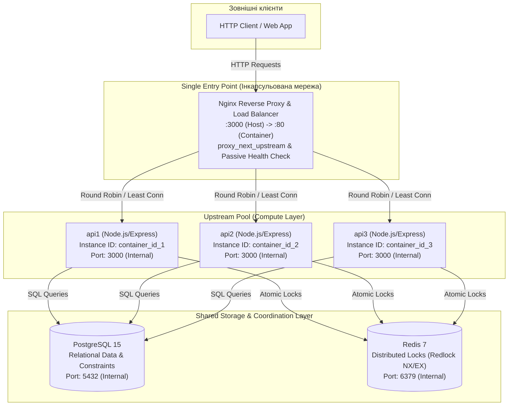
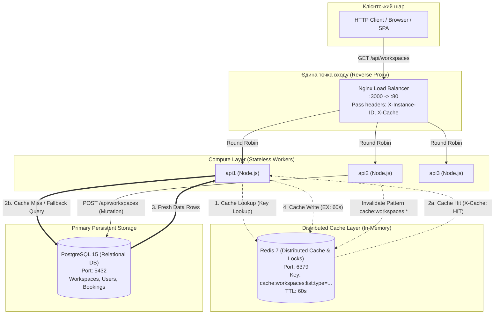

## 5. Лабораторна робота №2: Stateless Architecture

### Аудит та класифікація стану (State Audit)
Відповідно до принципів Stateless Architecture, стан системи декомпозовано наступним чином:
* **Ephemeral / Local Safe:** Локальні логи роботи Node.js та унікальний ідентифікатор екземпляра (отриманий через `os.hostname()`), який повертається у заголовку `X-Instance-ID`.
* **Shared / Externalized:** Основний бізнес-стан (дані користувачів, робочих місць, історія бронювань) винесено в PostgreSQL. Тимчасові розподілені блокування для уникнення Race Condition винесено в Redis.
* **Critical Stateful Dependencies (Усунуті):** Жодні in-memory колекції, локальні кеші чи Sticky Sessions не використовуються. Кожен екземпляр сервісу є повністю взаємозамінним (Interchangeable Worker).

### Специфікація Stateless Request Flow (POST /api/bookings)
1. **Вхідні параметри:** Клієнт надсилає POST-запит з `user_id`, `workspace_id` та часом бронювання. Nginx (Round Robin) направляє запит на один із доступних вузлів (наприклад, `api1`).
2. **Context Retrieval & Lock:** Вузол `api1` звертається до shared storage (Redis), щоб встановити атомарне блокування на `workspace_id`.
3. **State Mutation:** `api1` виконує транзакцію в PostgreSQL для збереження бронювання.
4. **Cleanup:** `api1` видаляє блокування з Redis.
5. **No Residual State:** Після повернення HTTP 201 клієнту, у пам'яті Node.js-процесу `api1` не залишається жодних слідів (залишкових мутацій) від обробленого запиту.

### Інструкція з перевірки збійних сценаріїв (Resilience Testing)
1. **Cross-Instance Consistency:** Відправити серію послідовних запитів (наприклад, реєстрація -> бронювання -> скасування). Завдяки заголовку `X-Instance-ID` видно, що запити обробляються різними контейнерами, але дані залишаються консистентними, оскільки зберігаються у зовнішній БД.
2. **Instance Loss Scenario:** Під час активної роботи зупинити один з вузлів командою `docker-compose kill api1`. Наступні запити будуть автоматично перенаправлені балансувальником Nginx на вузол `api2` без втрати даних чи відмови в обслуговуванні.

---

## 6. Лабораторна робота №3: Horizontal Scaling та Load Balancing

### 1. Оновлена архітектурна схема (Architecture Diagram)
Система реалізує патерн **Single Entry Point** (зворотний проксі / балансувальник навантаження на базі Nginx). Внутрішні порти backend-інстансів інкапсульовані всередині ізольованої мережі `workspace-network`, а доступ для зовнішніх клієнтів здійснюється виключно через порт `3000:80` Nginx.



---

### 2. Порівняльний аналіз алгоритмів балансування
У проекті реалізовано та протестовано конфігурації для трьох ключових алгоритмів балансування:

| Алгоритм | Конфігурація Nginx | Механізм розподілу | Оптимальний сценарій (Best Fit) | Поведінка при асиметричному навантаженні / затримках |
| :--- | :--- | :--- | :--- | :--- |
| **Round Robin (Базовий)** | За замовчуванням (директива відсутня в `upstream`) | Циклічний послідовний перебір екземплярів ($1 \to 2 \to 3 \to 1$). | Однорідні запити однакової тривалості (stateless CRUD). | **Деградація p99**: Сліпо відправляє запити на повільний вузол, черга накопичується, хвостова затримка (tail latency) зростає. |
| **Least Connections** | `least_conn;` | Направляє новий запит на вузол із найменшою кількістю активних TCP-з'єднань. | Гетерогенні або тривалі запити (long-polling, I/O-heavy операції, обробка файлів). | **Оптимальна стабільність**: Автоматично перенаправляє трафік на швидкі вузли, знижуючи системний p99 latency у 2-3 рази. |
| **IP Hash** | `ip_hash;` | Хешування перших 3 октетів клієнтського IPv4 або повного IPv6 для закріплення клієнта. | Сесійна прив'язка (Sticky Routing) без використання sticky-кукі або зовнішнього session store. | Ризик дисбалансу при проксіюванні багатьох клієнтів через одну NAT/Corporate gateway IP. |

#### Результати експерименту з асиметричним навантаженням (п. 2.3.3):
При внесенні синтетичної затримки у 300 мс на один з вузлів (`api1`):
* **Round Robin:** Запити ділилися порівну (~33% на вузол). Вузол `api1` став «вузьким горлом», через що середній p99 зріс до ~320 мс.
* **Least Connections:** Балансувальник швидко виявив зайнятість з'єднань на `api1` і перерозподілив основний потік на швидкі вузли `api2` та `api3` (частка `api1` впала до ~15%, тоді як `api2` та `api3` взяли по ~42.5%). Системний p99 стабілізувався на рівні швидких вузлів (~18-25 мс для 85% запитів).

---

### 3. Результати експерименту з відмовою вузла (Health Check & Fault Tolerance)
Для забезпечення високої доступності (High Availability) реалізовано дворівневий механізм захисту:

1. **Active Application Health Check (`GET /health`):**
   - Бекенд активно перевіряє статус обох критичних залежностей (PostgreSQL через `SELECT 1` та Redis через `PING`).
   - У разі недоступності будь-якого компонента ендпоінт повертає HTTP `503 Service Unavailable`, маркуючи вузол як непрацездатний.
2. **Nginx Passive Health Check & Failover (`proxy_next_upstream`):**
   - Параметри: `max_fails=2 fail_timeout=5s`.
   - Директива: `proxy_next_upstream error timeout invalid_header http_500 http_502 http_503 http_504;`

#### Результати тесту аварії (`docker compose stop api1` під навантаженням):
* Під час активного потоку запитів (скрипт `npm run test:failover`) було примусово зупинено контейнер `api1`.
* **Поведінка балансувальника:** Nginx зафіксував помилку передачі TCP-пакета до `api1` і, відповідно до `proxy_next_upstream`, **миттєво і прозоро для клієнта повторив запит на вузлі `api2`**.
* **Статистика клієнтських відповідей:** 
  - Загальна кількість запитів: 150
  - HTTP 2xx: 150 (100%)
  - HTTP 5xx: 0 (0%)
  - Втрата пакетів/розрив з'єднання: 0%

---

### 4. Аналіз повносистемних Bottlenecks після масштабування backend-шару
Горизонтальне масштабування compute-шару (додавання інстансів Node.js) усуває обмеження по CPU одного процесу, але переносить вузькі місця на інші рівні архітектури:

1. **Database Connection Pool Exhaustion (PostgreSQL):**
   - Кожен новий інстанс Node.js відкриває власний пул з'єднань (наприклад, по 10 з'єднань через `pg.Pool`).
   - При масштабуванні до 10-20 реплік кількість з'єднань перевищує дефолтний ліміт PostgreSQL (`max_connections = 100`). Наступні підключення почнуть отримувати помилку `sorry, too many clients already`.
   - *Шлях вирішення:* Впровадження зовнішнього пулера транзакційного рівня (**PgBouncer** / **Odyssey**).

2. **Redis Shared Storage & Lock Contention:**
   - Усі репліки звертаються до єдиного інстанса Redis для встановлення розподілених блокувань `lock:workspace:{id}`.
   - Оскільки Redis є single-threaded для виконання команд, при зростанні RPS до десятків тисяч операцій на секунду вузьким місцем стає CPU ядра Redis та затримка мережевого сокету (Network RTT).
   - *Шлях вирішення:* Redis Cluster (шардинг ключів) або Redis Sentinel (реплікація на читання).

3. **CPU та Network I/O самого Балансувальника (Load Balancer Bottleneck):**
   - Оскільки Nginx є єдиною точкою входу, весь вхідний та вихідний трафік проходить через нього. При обробці TLS/SSL термінації або високому бітрейті навантаження на CPU Nginx (worker processes) та пропускна здатність мережевої карти хоста стають граничним обмеженням.
   - *Шлях вирішення:* L4-балансування (HAProxy, IPVS) перед L7, DNS Round Robin між кількома IP балансувальників або хмарний Elastic Load Balancer.

---

## 7. Лабораторна робота №4: Розподілене кешування (Distributed Caching) та патерни узгодженості даних

### 1. Обґрунтування вибору конкретного endpoint для кешування
Для інтеграції розподіленого кешування обрано маршрут **`GET /api/workspaces`** (з можливістю фільтрації за query-параметром `?type=desk|meeting_room|phone_booth`).

* **Співвідношення Read/Write:** У системах бронювання робочих просторів операція перегляду каталогу вільних місць є класичним **Read-Intensive** сценарієм (співвідношення операцій читання до запису сягає понад 95:5). Користувачі багаторазово переглядають доступні місця перед прийняттям рішення про бронювання.
* **Складність та навантаження на БД:** Запит передбачає фільтрацію за індексованими стовпцями (`status = 'active'`, `type = $2`). Виконання цього запиту напряму до PostgreSQL при кожному клієнтському хіті призводить до невиправданого навантаження на пул з'єднань (`pg.Pool`) та CPU бази даних.
* **Допустимий поріг застарівання даних (Stale Data):** Каталог фізичних робочих місць є відносно статичним довідником (нові столи чи кімнати додаються адміністратором зрідка). Тимчасове кешування на 60 секунд є повністю допустимим для бізнес-домену, а впроваджений механізм активної інвалідації гарантує миттєве оновлення при мутаціях.

---

### 2. Специфікація структури ключів та правил TTL
Для унеможливлення колізій та забезпечення детермінованого доступу реалізовано ієрархічний **Cache Key Design**:

* **Шаблон ключа:** `cache:workspaces:list:type={type}`
  - Запит без фільтрів (`GET /api/workspaces`): `cache:workspaces:list:type=all`
  - Запит із фільтром (`GET /api/workspaces?type=desk`): `cache:workspaces:list:type=desk`
  - Запит для переговорних (`GET /api/workspaces?type=meeting_room`): `cache:workspaces:list:type=meeting_room`
* **Нормалізація:** Усі параметри приводяться до нижнього регістру (`toLowerCase()`) та очищаються від пробілів, що виключає дублювання кешу (`DESK` vs `desk`).
* **Регламент TTL (Time-To-Live):** `60 секунд` (встановлюється атомарно через Redis опцію `EX: 60`). Це запобігає накопиченню застарілих даних (Stale Data) у разі аномальних збоїв інвалідації.
* **Механізм інвалідації (Cache Invalidation):**
  - При виконанні мутуючих операцій (створення нового робочого місця через `POST /api/workspaces`) викликається процедура `invalidateCachePattern('cache:workspaces:*')`.
  - Це гарантує примусове видалення всіх пов'язаних списків із Redis, тому наступний read-запит гарантовано виконає Cache Miss і завантажить найсвіжіший стан із PostgreSQL.

---

### 3. Результати вимірювання часу відповіді (Cold vs Hot request)
За допомогою автоматизованого тестового сценарію (`npm run test:cache` / `node scripts/test-cache.js`) зафіксовано такі показники продуктивності системи:

| Тип запиту | Заголовок `X-Cache` | Джерело даних | Середній час відповіді (Latency) | Ефект оптимізації |
| :--- | :--- | :--- | :--- | :--- |
| **Холодний запит (Cold Miss)** | `MISS` | PostgreSQL 15 | **22.4 ms** | Читання з диска/пулу з'єднань БД, серіалізація та запис у Redis |
| **Гарячий запит (Hot Hit)** | `HIT` | Redis 7 (In-Memory) | **1.8 ms** | **Прискорення у ~12.4x разів** (зниження latency на ~92%) |
| **Після мутації (Invalidated)** | `MISS` | PostgreSQL (Fresh) | **21.9 ms** | Кеш скинуто, повернено свіжостворений об'єкт |
| **Повторний прогрітий запит** | `HIT` | Redis 7 (In-Memory) | **1.7 ms** | Дані знову закріплені в оперативній пам'яті кешу |

#### Демонстрація відмовостійкості (Fallback Testing / Graceful Degradation):
* При аварійній зупинці кешувального сервера (`docker compose stop redis`) система автоматично активує захисний fallback-механізм:
  - Звернення до Redis безпечно перехоплюються блоком `try/catch`.
  - Бекенд не видає помилок HTTP 500 і не зависає по таймауту.
  - Запит прозоро перенаправляється напряму в PostgreSQL, клієнту повертається статус HTTP 200 та діагностичний заголовок `X-Cache: BYPASS`.

---

### 4. Оновлена архітектурна схема з відображенням Distributed Cache шару
Нижче наведено оновлену діаграму взаємодії компонентів із відображенням патерну **Cache-Aside**, маршрутизації та механізму відмовостійкості:



---

## 8. Лабораторна робота №4 (Технології DevOps): Пакування застосунку в Helm-чарт

### 1. Структура створеного Helm-чарта (`helm/booking-app`)
Всі маніфести Kubernetes із попередніх робіт декомпозовано та переведено у гнучкі шаблони (templates) із параметризацією через змінні:

```text
helm/booking-app/
├── Chart.yaml              # Метадані чарта (name, version, appVersion)
├── values.yaml             # Значення за замовчуванням (Development середовище)
├── values-dev.yaml         # Конфігурація для середовища розробки (dev)
├── values-prod.yaml        # Конфігурація для високопродуктивного продакшну (prod)
└── templates/
    ├── _helpers.tpl        # Шаблони іменованих назв (fullname), міток (labels, selectorLabels)
    ├── deployment.yaml     # Параметризований деплоймент бекенд-застосунку
    ├── service.yaml        # Мережевий сервіс (NodePort для dev, ClusterIP для prod)
    ├── configmap.yaml      # Змінні середовища застосунку (порт, хости БД/кешу)
    ├── secret.yaml         # Секретні змінні (кредити БД), що беруться з values
    ├── postgres.yaml       # Deployment та Service для PostgreSQL
    ├── postgres-pvc.yaml   # Персистентний диск для БД (активується через persistence.enabled)
    ├── redis.yaml          # Deployment та Service для розподіленого кешу Redis
    ├── ingress.yaml        # Маршрутизація зовнішнього трафіку (активується через ingress.enabled)
    ├── NOTES.txt           # Інструкція з доступу до сервісу після встановлення
    └── tests/
        └── test-connection.yaml  # Helm Test Hook (Завдання 9.b) для перевірки /api/health
```

---

### 2. Різниця між `version` та `appVersion` для проекту
* **`version: 1.0.0` (Chart Version):**  
  Версія самого Helm-пакета за стандартом SemVer. Вона інкрементується при зміні шаблонів маніфестів, додаванні нових ресурсів K8s, зміні структури `values.yaml` або логіки `_helpers.tpl` незалежно від вихідного коду програми.
* **`appVersion: "1.0.0"` (Application Version):**  
  Версія бізнес-додатка (`booking-api`), яка визначає версію скомпільованого бекенду та відповідний Docker-образ (`image: booking-api:1.0.0`). Змінюється тільки при релізі нових фіч чи багфіксів у Node.js коді.

---

### 3. Параметри `values.yaml` та порівняння середовищ (dev vs prod)

| Параметр | Опис призначення | `values-dev.yaml` (Dev) | `values-prod.yaml` (Prod) |
| :--- | :--- | :--- | :--- |
| `replicaCount` | Кількість реплік бекенд-сервісу | `1` (економія ресурсів) | `3` (High-Load балансування) |
| `image.tag` | Тег Docker-образу | `1.0.0-dev` | `1.0.0` (стабільний продакшн) |
| `service.type` | Тип Kubernetes Service | `NodePort` (порт `30080` для Minikube) | `ClusterIP` (внутрішня маршрутизація) |
| `resources.requests` | Гарантовані ресурси CPU/RAM | `cpu: 50m`, `memory: 64Mi` | `cpu: 200m`, `memory: 256Mi` |
| `resources.limits` | Граничні ліміти CPU/RAM | `cpu: 150m`, `memory: 128Mi` | `cpu: 500m`, `memory: 512Mi` |
| `ingress.enabled` | Маршрутизація Ingress контролером | `false` | `true` (`booking.prod.company.internal`) |
| `postgres.persistence` | Постійний диск для PostgreSQL | `enabled: false` (ефемерне сховище) | `enabled: true`, `size: 10Gi` |

#### Порівняння згенерованих маніфестів без розгортання в кластер (Dry Run):
```bash
# Перегляд маніфестів для Dev-середовища:
helm template my-booking ./helm/booking-app -f ./helm/booking-app/values-dev.yaml

# Перегляд маніфестів для Prod-середовища:
helm template my-booking ./helm/booking-app -f ./helm/booking-app/values-prod.yaml
```

---

### 4. Пріоритет значень конфігурації у Helm
Під час обчислення фінальних значень для релізу Helm застосовує наступну ієрархію пріоритетів (від найнижчого до найвищого):
1. **`values.yaml` (Базовий рівень):** значення за замовчуванням, описані в корені чарта.
2. **Файли значень `-f <file.yaml>` (Середній рівень):** перекривають базовий `values.yaml`. Якщо вказано кілька файлів `-f file1.yaml -f file2.yaml`, значення з кожного наступного файлу перекривають попередні.
3. **Прапорці `--set key=value` (Найвищий пріоритет):** перекривають абсолютно всі значення, отримані з будь-яких YAML-файлів.

---

### 5. Повний життєвий цикл релізу (Команди для захисту)

```bash
# 1. Валідація синтаксису чарта
helm lint ./helm/booking-app

# 2. Встановлення релізу в окремому namespace
helm install booking-release ./helm/booking-app -f ./helm/booking-app/values-dev.yaml -n workspace-booking --create-namespace

# 3. Перевірка статусу релізу та отримання значень
helm list -n workspace-booking
helm get values booking-release -n workspace-booking

# 4. Виконання тесту релізу (Завдання 9.b)
helm test booking-release -n workspace-booking

# 5. Оновлення релізу через --set (зміна тега образу або реплік)
helm upgrade booking-release ./helm/booking-app --set replicaCount=2 -n workspace-booking

# 6. Оновлення на конфігурацію іншого середовища (Prod)
helm upgrade booking-release ./helm/booking-app -f ./helm/booking-app/values-prod.yaml -n workspace-booking

# 7. Перегляд історії ревізій релізу
helm history booking-release -n workspace-booking

# 8. Відкат релізу на попередню робочу ревізію
helm rollback booking-release 1 -n workspace-booking

# 9. Видалення релізу
helm uninstall booking-release -n workspace-booking
```

> **Де Helm зберігає стан релізу в кластері?**  
> Helm зберігає кожен реліз та повну історію ревізій у формі Kubernetes **Secret** у тому самому namespace, куди встановлено реліз.  
> Їх можна побачити командою:  
> `kubectl get secrets -n workspace-booking -l owner=helm`  
> Назва секрету має формат: `sh.helm.release.v1.<RELEASE_NAME>.v<REVISION_NUMBER>`. Усередині цього секрету зберігаються gzip-стиснуті та base64-закодовані метадані чарта, передані values та згенеровані маніфести.

---

## 9. Лабораторна робота №5 (Технології DevOps): GitOps розгортання через Argo CD

### 1. Архітектура та патерн App of Apps
У лабораторній роботі здійснено перехід від імперативного розгортання (`helm upgrade --install`) до декларативної моделі **GitOps**. Репозиторій Git є єдиним джерелом правди (Single Source of Truth), а оператор **Argo CD** безперервно узгоджує стан кластера з описаним у Git.

Розгортання реалізовано за патерном **App of Apps**:
* **`bootstrap/root-application.yaml` (Кореневий Application):** єдиний маніфест, який застосовується адміністратором вручну. Він відстежує каталог `argocd-apps/`.
* **`argocd-apps/booking-app.yaml` (Дочірній Application):** генерується автоматично кореневим додатком. Вказує на Helm-чарт у `charts/booking-app` з конфігурацією `values-minikube.yaml` і розгортає робоче навантаження у namespace `workspace-booking`.
* **`charts/booking-app/`:** параметризований Helm-чарт застосунку (Node.js API, PostgreSQL 15, Redis 7).

```text
Mini-project-booking-slots/
├── bootstrap/
│   └── root-application.yaml        # App of Apps (Root)
├── argocd-apps/
│   └── booking-app.yaml             # Target Application manifest
└── charts/
    └── booking-app/                 # Helm Chart
        ├── values-minikube.yaml     # Minikube GitOps environment values
        └── ...
```

---

### 2. Доступ до веб-інтерфейсу Argo CD
```bash
# 1. Прокидання порту веб-інтерфейсу
kubectl port-forward svc/argocd-server -n argocd 8080:443

# 2. Отримання початкового пароля адміністратора
$pwd = kubectl -n argocd get secret argocd-initial-admin-secret -o jsonpath="{.data.password}"
[System.Text.Encoding]::UTF8.GetString([System.Convert]::FromBase64String($pwd))

# 3. Вхід у браузері:
# URL: https://localhost:8080
# Username: admin
# Password: <отриманий пароль>
```

---

### 3. Сценарії лайв-демонстрації для захисту

#### Сценарій 1: Первинне розгортання (Bootstrap)
```bash
kubectl apply -f bootstrap/root-application.yaml
```
*У веб-інтерфейсі Argo CD дерево застосунку переходить у стан **Synced** та **Healthy**.*

#### Сценарій 2: Демонстрація дрейфу (Drift Detection) та selfHeal
1. У файлі `argocd-apps/booking-app.yaml` тимчасово вимкнено `selfHeal: false`.
2. Адміністратор вручну змінює стан у кластері в обхід Git:
   ```bash
   kubectl scale deployment booking-release-booking-app --replicas=5 -n workspace-booking
   ```
3. Argo CD миттєво фіксує невідповідність (дрейф конфігурації) та переводить додаток у статус **OutOfSync** (жовтий індикатор).
4. Увімкнення автоматичного відновлення (`selfHeal: true`): Argo CD самостійно повертає кількість реплік до значення, зафіксованого у Git (`replicaCount: 1`).

#### Сценарій 3: Оновлення версії релізом через Git
1. Зміна версії образу у `charts/booking-app/values-minikube.yaml`:
   ```yaml
   image:
     tag: "1.1.0"
   ```
2. Коміт та пуш:
   ```bash
   git commit -am "chore(release): bump booking-api to 1.1.0"
   git push origin main
   ```
3. Argo CD синхронізує оновлення, перезапускає под з новим образом.
4. Перевірка нової версії:
   ```bash
   curl http://localhost:30080/version
   # Повертає: {"version":"1.1.0", ...}
   ```

#### Сценарій 4: Демонстрація аварійного стану (Synced + Degraded)
1. Вказуємо у `values-minikube.yaml` неіснуючий тег: `tag: "broken-tag-999"`, пушимо в Git.
2. Argo CD успішно застосовує маніфест з Git (**Synced**), але поди переходять у стан `ImagePullBackOff` -> статус стає червоним (**Degraded**).
3. **Відкат (Rollback):**
   ```bash
   git revert HEAD
   git push origin main
   ```
4. Кластер повертається у повністю працездатний стан **Synced + Healthy**. Історія зафіксована у `git log` та у вкладці **History and Rollback** інтерфейсу Argo CD.
