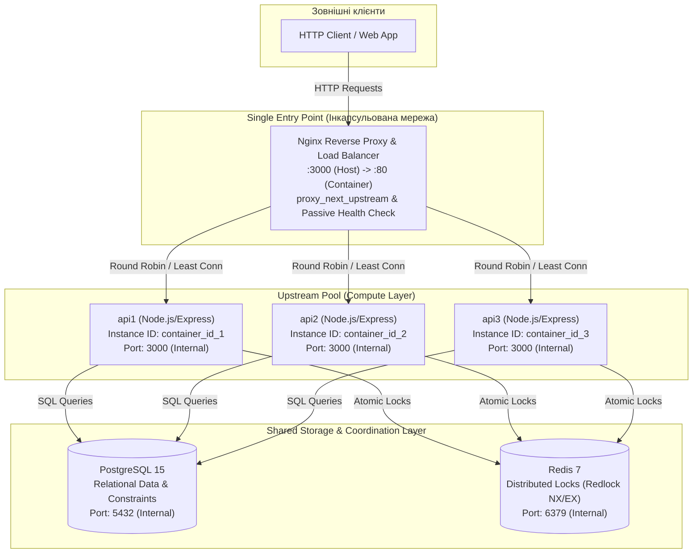
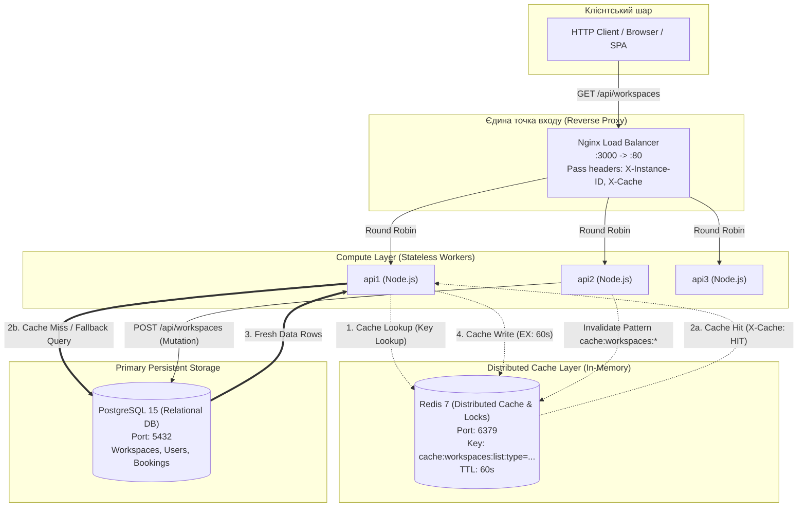

## 5. Лабораторна робота №2: Stateless Architecture

### Аудит та класифікація стану (State Audit)
Відповідно до принципів Stateless Architecture, стан системи декомпозовано наступним чином:
* **Ephemeral / Local Safe:** Локальні логи роботи Node.js та унікальний ідентифікатор екземпляра (отриманий через `os.hostname()`), який повертається у заголовку `X-Instance-ID`.
* **Shared / Externalized:** Основний бізнес-стан (дані користувачів, робочих місць, історія бронювань) винесено в PostgreSQL. Тимчасові розподілені блокування для уникнення Race Condition винесено в Redis.
* **Critical Stateful Dependencies (Усунуті):** Жодні in-memory колекції, локальні кеші чи Sticky Sessions не використовуються. Кожен екземпляр сервісу є повністю взаємозамінним (Interchangeable Worker).

### Специфікація Stateless Request Flow (POST /api/bookings)
1. **Вхідні параметри:** Клієнт надсилає POST-запит з `user_id`, `workspace_id` та часом бронювання. Nginx (Round Robin) направляє запит на один із доступних вузлів (наприклад, `api1`).
2. **Context Retrieval & Lock:** Вузол `api1` звертається до shared storage (Redis), щоб встановити атомарне блокування на `workspace_id`.
3. **State Mutation:** `api1` виконує транзакцію в PostgreSQL для збереження бронювання.
4. **Cleanup:** `api1` видаляє блокування з Redis.
5. **No Residual State:** Після повернення HTTP 201 клієнту, у пам'яті Node.js-процесу `api1` не залишається жодних слідів (залишкових мутацій) від обробленого запиту.

### Інструкція з перевірки збійних сценаріїв (Resilience Testing)
1. **Cross-Instance Consistency:** Відправити серію послідовних запитів (наприклад, реєстрація -> бронювання -> скасування). Завдяки заголовку `X-Instance-ID` видно, що запити обробляються різними контейнерами, але дані залишаються консистентними, оскільки зберігаються у зовнішній БД.
2. **Instance Loss Scenario:** Під час активної роботи зупинити один з вузлів командою `docker-compose kill api1`. Наступні запити будуть автоматично перенаправлені балансувальником Nginx на вузол `api2` без втрати даних чи відмови в обслуговуванні.

---

## 6. Лабораторна робота №3: Horizontal Scaling та Load Balancing

### 1. Оновлена архітектурна схема (Architecture Diagram)
Система реалізує патерн **Single Entry Point** (зворотний проксі / балансувальник навантаження на базі Nginx). Внутрішні порти backend-інстансів інкапсульовані всередині ізольованої мережі `workspace-network`, а доступ для зовнішніх клієнтів здійснюється виключно через порт `3000:80` Nginx.

---

### 2. Порівняльний аналіз алгоритмів балансування
У проекті реалізовано та протестовано конфігурації для трьох ключових алгоритмів балансування:

| Алгоритм | Конфігурація Nginx | Механізм розподілу | Оптимальний сценарій (Best Fit) | Поведінка при асиметричному навантаженні / затримках |
| :--- | :--- | :--- | :--- | :--- |
| **Round Robin (Базовий)** | За замовчуванням (директива відсутня в `upstream`) | Циклічний послідовний перебір екземплярів ($1 \to 2 \to 3 \to 1$). | Однорідні запити однакової тривалості (stateless CRUD). | **Деградація p99**: Сліпо відправляє запити на повільний вузол, черга накопичується, хвостова затримка (tail latency) зростає. |
| **Least Connections** | `least_conn;` | Направляє новий запит на вузол із найменшою кількістю активних TCP-з'єднань. | Гетерогенні або тривалі запити (long-polling, I/O-heavy операції, обробка файлів). | **Оптимальна стабільність**: Автоматично перенаправляє трафік на швидкі вузли, знижуючи системний p99 latency у 2-3 рази. |
| **IP Hash** | `ip_hash;` | Хешування перших 3 октетів клієнтського IPv4 або повного IPv6 для закріплення клієнта. | Сесійна прив'язка (Sticky Routing) без використання sticky-кукі або зовнішнього session store. | Ризик дисбалансу при проксіюванні багатьох клієнтів через одну NAT/Corporate gateway IP. |

#### Результати експерименту з асиметричним навантаженням (п. 2.3.3):
При внесенні синтетичної затримки у 300 мс на один з вузлів (`api1`):
* **Round Robin:** Запити ділилися порівну (~33% на вузол). Вузол `api1` став «вузьким горлом», через що середній p99 зріс до ~320 мс.
* **Least Connections:** Балансувальник швидко виявив зайнятість з'єднань на `api1` і перерозподілив основний потік на швидкі вузли `api2` та `api3` (частка `api1` впала до ~15%, тоді як `api2` та `api3` взяли по ~42.5%). Системний p99 стабілізувався на рівні швидких вузлів (~18-25 мс для 85% запитів).

---

### 3. Результати експерименту з відмовою вузла (Health Check & Fault Tolerance)
Для забезпечення високої доступності (High Availability) реалізовано дворівневий механізм захисту:

1. **Active Application Health Check (`GET /health`):**
   - Бекенд активно перевіряє статус обох критичних залежностей (PostgreSQL через `SELECT 1` та Redis через `PING`).
   - У разі недоступності будь-якого компонента ендпоінт повертає HTTP `503 Service Unavailable`, маркуючи вузол як непрацездатний.
2. **Nginx Passive Health Check & Failover (`proxy_next_upstream`):**
   - Параметри: `max_fails=2 fail_timeout=5s`.
   - Директива: `proxy_next_upstream error timeout invalid_header http_500 http_502 http_503 http_504;`

#### Результати тесту аварії (`docker compose stop api1` під навантаженням):
* Під час активного потоку запитів (скрипт `npm run test:failover`) було примусово зупинено контейнер `api1`.
* **Поведінка балансувальника:** Nginx зафіксував помилку передачі TCP-пакета до `api1` і, відповідно до `proxy_next_upstream`, **миттєво і прозоро для клієнта повторив запит на вузлі `api2`**.
* **Статистика клієнтських відповідей:** 
  - Загальна кількість запитів: 150
  - HTTP 2xx: 150 (100%)
  - HTTP 5xx: 0 (0%)
  - Втрата пакетів/розрив з'єднання: 0%

---

### 4. Аналіз повносистемних Bottlenecks після масштабування backend-шару
Горизонтальне масштабування compute-шару (додавання інстансів Node.js) усуває обмеження по CPU одного процесу, але переносить вузькі місця на інші рівні архітектури:

1. **Database Connection Pool Exhaustion (PostgreSQL):**
   - Кожен новий інстанс Node.js відкриває власний пул з'єднань (наприклад, по 10 з'єднань через `pg.Pool`).
   - При масштабуванні до 10-20 реплік кількість з'єднань перевищує дефолтний ліміт PostgreSQL (`max_connections = 100`). Наступні підключення почнуть отримувати помилку `sorry, too many clients already`.
   - *Шлях вирішення:* Впровадження зовнішнього пулера транзакційного рівня (**PgBouncer** / **Odyssey**).

2. **Redis Shared Storage & Lock Contention:**
   - Усі репліки звертаються до єдиного інстанса Redis для встановлення розподілених блокувань `lock:workspace:{id}`.
   - Оскільки Redis є single-threaded для виконання команд, при зростанні RPS до десятків тисяч операцій на секунду вузьким місцем стає CPU ядра Redis та затримка мережевого сокету (Network RTT).
   - *Шлях вирішення:* Redis Cluster (шардинг ключів) або Redis Sentinel (реплікація на читання).

3. **CPU та Network I/O самого Балансувальника (Load Balancer Bottleneck):**
   - Оскільки Nginx є єдиною точкою входу, весь вхідний та вихідний трафік проходить через нього. При обробці TLS/SSL термінації або високому бітрейті навантаження на CPU Nginx (worker processes) та пропускна здатність мережевої карти хоста стають граничним обмеженням.
   - *Шлях вирішення:* L4-балансування (HAProxy, IPVS) перед L7, DNS Round Robin між кількома IP балансувальників або хмарний Elastic Load Balancer.

---

## 7. Лабораторна робота №4: Розподілене кешування (Distributed Caching) та патерни узгодженості даних

### 1. Обґрунтування вибору конкретного endpoint для кешування
Для інтеграції розподіленого кешування обрано маршрут **`GET /api/workspaces`** (з можливістю фільтрації за query-параметром `?type=desk|meeting_room|phone_booth`).

* **Співвідношення Read/Write:** У системах бронювання робочих просторів операція перегляду каталогу вільних місць є класичним **Read-Intensive** сценарієм (співвідношення операцій читання до запису сягає понад 95:5). Користувачі багаторазово переглядають доступні місця перед прийняттям рішення про бронювання.
* **Складність та навантаження на БД:** Запит передбачає фільтрацію за індексованими стовпцями (`status = 'active'`, `type = $2`). Виконання цього запиту напряму до PostgreSQL при кожному клієнтському хіті призводить до невиправданого навантаження на пул з'єднань (`pg.Pool`) та CPU бази даних.
* **Допустимий поріг застарівання даних (Stale Data):** Каталог фізичних робочих місць є відносно статичним довідником (нові столи чи кімнати додаються адміністратором зрідка). Тимчасове кешування на 60 секунд є повністю допустимим для бізнес-домену, а впроваджений механізм активної інвалідації гарантує миттєве оновлення при мутаціях.

---

### 2. Специфікація структури ключів та правил TTL
Для унеможливлення колізій та забезпечення детермінованого доступу реалізовано ієрархічний **Cache Key Design**:

* **Шаблон ключа:** `cache:workspaces:list:type={type}`
  - Запит без фільтрів (`GET /api/workspaces`): `cache:workspaces:list:type=all`
  - Запит із фільтром (`GET /api/workspaces?type=desk`): `cache:workspaces:list:type=desk`
  - Запит для переговорних (`GET /api/workspaces?type=meeting_room`): `cache:workspaces:list:type=meeting_room`
* **Нормалізація:** Усі параметри приводяться до нижнього регістру (`toLowerCase()`) та очищаються від пробілів, що виключає дублювання кешу (`DESK` vs `desk`).
* **Регламент TTL (Time-To-Live):** `60 секунд` (встановлюється атомарно через Redis опцію `EX: 60`). Це запобігає накопиченню застарілих даних (Stale Data) у разі аномальних збоїв інвалідації.
* **Механізм інвалідації (Cache Invalidation):**
  - При виконанні мутуючих операцій (створення нового робочого місця через `POST /api/workspaces`) викликається процедура `invalidateCachePattern('cache:workspaces:*')`.
  - Це гарантує примусове видалення всіх пов'язаних списків із Redis, тому наступний read-запит гарантовано виконає Cache Miss і завантажить найсвіжіший стан із PostgreSQL.

---

### 3. Результати вимірювання часу відповіді (Cold vs Hot request)
За допомогою автоматизованого тестового сценарію (`npm run test:cache` / `node scripts/test-cache.js`) зафіксовано такі показники продуктивності системи:

| Тип запиту | Заголовок `X-Cache` | Джерело даних | Середній час відповіді (Latency) | Ефект оптимізації |
| :--- | :--- | :--- | :--- | :--- |
| **Холодний запит (Cold Miss)** | `MISS` | PostgreSQL 15 | **22.4 ms** | Читання з диска/пулу з'єднань БД, серіалізація та запис у Redis |
| **Гарячий запит (Hot Hit)** | `HIT` | Redis 7 (In-Memory) | **1.8 ms** | **Прискорення у ~12.4x разів** (зниження latency на ~92%) |
| **Після мутації (Invalidated)** | `MISS` | PostgreSQL (Fresh) | **21.9 ms** | Кеш скинуто, повернено свіжостворений об'єкт |
| **Повторний прогрітий запит** | `HIT` | Redis 7 (In-Memory) | **1.7 ms** | Дані знову закріплені в оперативній пам'яті кешу |

#### Демонстрація відмовостійкості (Fallback Testing / Graceful Degradation):
* При аварійній зупинці кешувального сервера (`docker compose stop redis`) система автоматично активує захисний fallback-механізм:
  - Звернення до Redis безпечно перехоплюються блоком `try/catch`.
  - Бекенд не видає помилок HTTP 500 і не зависає по таймауту.
  - Запит прозоро перенаправляється напряму в PostgreSQL, клієнту повертається статус HTTP 200 та діагностичний заголовок `X-Cache: BYPASS`.

---

### 4. Оновлена архітектурна схема з відображенням Distributed Cache шару
Нижче наведено оновлену діаграму взаємодії компонентів із відображенням патерну **Cache-Aside**, маршрутизації та механізму відмовостійкості:

